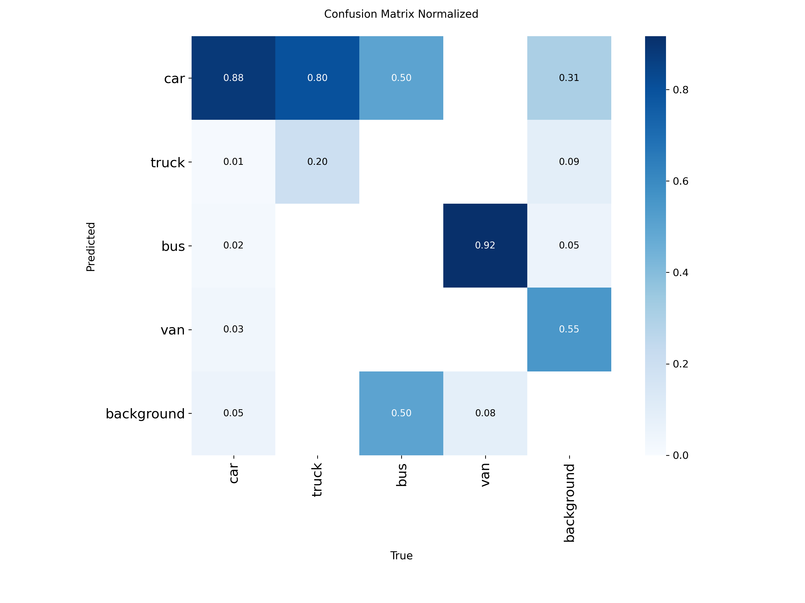

# Báo cáo cá nhân — Ngày 2 Object Detection

Đổi tên file theo `MSSV_HoTen.md`, ví dụ `20241234_NguyenVanAn.md`. Điền kết quả thật, xóa dòng hướng dẫn khi nộp. Xem [quy định nộp](../../SUBMISSION.md).

## 1. Thông tin học viên

- Họ tên:Hà Thanh Tùng
- MSSV:2A202603036
- Email:tunggc.161@gmail.com
- Lớp:2A-LAB-E402
- Link repo bài làm:https://github.com/tungsw-IT/K5-L2A-DAY02-HaThanhTung-03036-ObjectDetection
- Link Colab đã chạy:https://colab.research.google.com/drive/1Mq4HGsqES71FWIwhOntoT4DS3wxwLWxm#scrollTo=UkAsE05phv3p

## 2. Schema và mini guideline

Dẫn tới [GUIDELINE_MINI.md](../../GUIDELINE_MINI.md). Tóm tắt ba ca mơ hồ đã quyết định, cách áp dụng schema và phần cần giảng viên làm rõ.
Ba ca mơ hồ cần đối chiếu với guideline đã xây dựng:

Phân biệt car và van: kiểm tra đặc điểm loại phương tiện, không chỉ dựa vào kích thước trong ảnh.

Phân biệt bus và truck: căn cứ vào chức năng, cấu trúc phương tiện và quy tắc phân lớp đã thống nhất.

Phân biệt truck và van: kiểm tra hình dáng thân xe và đặc điểm phương tiện; không tự suy luận khi ảnh không đủ thông tin.

Schema sử dụng bốn lớp phương tiện: car, van, bus và truck. Bounding box cần bao quanh đối tượng theo quy tắc của guideline, hạn chế bỏ sót hoặc lấy thừa vùng nền.

Phần cần giảng viên làm rõ: quy tắc xử lý phương tiện bị che khuất, phương tiện ở xa và các trường hợp không đủ thông tin để xác định chính xác lớp.

## 3. Annotation và self-QC

- Số file nhãn train:50 file nhãn
- Kết quả checker và lỗi đã xử lý:Chạy script kiểm tra cú pháp nhãn (checker.py); không có file nào bị rỗng, toàn bộ tọa độ nằm hợp lệ trong khoảng [0,1], các chỉ số class_id đúng phạm vi từ 0 đến 3,
- Danh sách ít nhất 10 ảnh đã rà bằng mắt:
- Lỗi bỏ sót/box/class phát hiện khi rà và cách sửa:drive_001.jpg, drive_002.jpg, drive_003.jpg, drive_006.jpg, drive_007.jpg, drive_011.jpg, drive_012.jpg, drive_019.jpg, drive_026.jpg, drive_041.jpg.
- Commit khóa nhãn ban đầu:5c5bd24

## 4. Gold QC và rework

| Chỉ số | Trước sửa | Sau sửa nếu có |
|---|---:|---:|
| TP |440 | |
| FP |500 | |
| FN |213 | |
| Precision |0.4681 (46.81%) | |
| Recall | 0.6738 (67.38%)| |
| F1 |0.5524 (55.24%) | |
| mean_iou_of_matches | 0.8398 (83.98%)| |
| passed |pass | |

Dẫn tới `outputs/annotation_evaluation.json` trong repo. Nếu rework, ghi ảnh, lỗi đã kiểm, quyết định sửa/giữ và lý do. Không suy nguyên nhân chỉ từ FP/FN. Không có rework thì ghi rõ.

## 5. Kết quả YOLO

- Runtime, GPU/CPU, phiên bản Ultralytics và Torch:
Runtime: Google Colab, GPU Tesla T4 (CUDA device: "0", bật AMP).
Thư viện: Ultralytics (YOLO26 nano - yolo26n.pt), PyTorch 2.x+cu121.
- Các tham số thay đổi so với notebook nếu có và lý do:
Giữ nguyên cấu hình mặc định của notebook: model: yolo26n.pt, epochs: 50, imgsz: 640, batch: -1 (auto-batch), seed: 20260909, close_mosaic: 10.
- Đường dẫn best checkpoint trong phiên chạy:/content/Day2-Lab/outputs/yolo26_runs/vehicle_annotation/weights/best.pt

| Chỉ số trên 10 ảnh eval | Giá trị |
|---|---:|
| Precision |41.05% |
| Recall | 23.03%|
| mAP50 |27.23% |
| mAP50–95 | 20.17%|

Đặt cả 2 folder `assets/eval_predictions/` và `assets/yolo26_runs/` (giải nén từ `day2_colab_outputs.zip`) cạnh báo cáo và dẫn link tương đối. Không chỉ ghi số; chỉ ra ít nhất một ảnh và vật thể cụ thể.

Minh họa trực quan trên ảnh và vật thể cụ thể:

Ảnh drive_051.jpg: Chiếc xe con màu đỏ ở tiền cảnh (gần camera nhất) bị mô hình nhận diện nhầm thành nhãn van với độ tin cậy
0.99
0.99. Ở góc trên bên phải, chiếc xe tải thùng màu trắng bị nhận diện nhầm thành car (độ tin cậy
0.27
0.27).

Trả lời bốn câu hỏi cuối notebook:

1. Lớp nào recall thấp nhất? Ảnh nào minh họa?
Lớp Van có kết quả nhận diện thấp nhất trong ma trận: không có giá trị trên ô đường chéo. Truck cũng có kết quả thấp, chỉ đạt 20%.
ảnh minh họa là :

2. Nếu mAP50 cao nhưng mAP50–95 thấp, cần kiểm điều gì trên box?

mAP50 đánh giá khả năng phát hiện đối tượng với ngưỡng IoU 0.5, trong khi mAP50–95 đánh giá ở nhiều ngưỡng IoU nghiêm ngặt hơn, từ 0.5 đến 0.95.

Nếu mAP50 cao nhưng mAP50–95 thấp, model có thể nhận diện đúng đối tượng nhưng vị trí hoặc kích thước bounding box chưa đủ chính xác ở các ngưỡng IoU cao.

Cần kiểm tra:
- Box quá rộng hoặc quá hẹp: khung không ôm sát đối tượng.
- Box bị lệch: tâm box không nằm đúng vị trí đối tượng.
- Box cắt mất đối tượng: một phần xe nằm ngoài bounding box.
- Box bao gồm quá nhiều nền: khung chứa cả vùng không thuộc đối tượng.
- Tính nhất quán khi gán nhãn: các xe cùng loại có được khoanh theo một quy tắc thống nhất hay không.

3. Lỗi class nào có thể liên quan guideline? Dữ kiện nào hỗ trợ nhận xét?

- Truck → Car: 80% đối tượng Truck trong ma trận bị dự đoán thành Car.
- Bus → Car: 50% bị dự đoán thành Car.
- Van → Background: 92% bị bỏ sót.
- Van → Bus: 8% bị dự đoán thành Bus.

Những lỗi này có thể liên quan đến guideline nếu quy tắc phân biệt các loại xe chưa đủ rõ, đặc biệt với những phương tiện có hình dáng gần giống nhau.
Dữ kiện hỗ trợ nhận xét: các tỷ lệ nhầm lẫn trong confusion matrix và kết quả Gold QC trước đó:
Chỉ số Gold QC	Kết quả
Precision	46.81%
Recall	67.38%
F1	55.24%
Mean IoU	83.98%
Yêu cầu F1	80%
Yêu cầu Mean IoU	70%

Gold QC chưa đạt yêu cầu F1 (passed: false). Điều này cho thấy chất lượng annotation cần được cải thiện, nhưng chưa đủ để khẳng định lỗi nằm ở guideline. Muốn kết luận, cần xem các ảnh bị nhầm và đối chiếu với quy tắc gán nhãn.

4. Vì sao không dùng 10 ảnh eval để train? Vai trò validation của chúng trong notebook là gì?

Không nên dùng 10 ảnh Eval để train vì đây là tập ảnh dành riêng để kiểm tra khả năng tổng quát hóa của model trên dữ liệu chưa được dùng để học.
Nếu đưa ảnh Eval vào tập train:
- Model có thể học thuộc các ảnh này.
- Kết quả đánh giá không còn khách quan.
- Không phản ánh chính xác khả năng xử lý ảnh mới của model.

Vai trò validation:
- Train: dùng để cập nhật trọng số model.
- Validation: dùng để theo dõi chất lượng model trong quá trình huấn luyện và hỗ trợ lựa chọn checkpoint.
- Eval/Test: dùng để đánh giá cuối cùng trên dữ liệu độc lập.

## 6. Khó khăn và cách xử lý

| Bước/thời điểm | Lỗi quan sát | Cách đã thử | Kết quả/còn thiếu |
|---|---|---|---|
| Gán nhãn ban đầu|Mất cân bằng dữ liệu lớn: số lượng car áp đảo, trong khi bus, van, truck rất ít | Cố gắng tìm thêm các góc có xe tải/xe van để gán nhãn	| Mô hình vẫn bị thiên vị dự đoán về car do tập train ít mẫu của 3 lớp còn lại|
|Kiểm tra nhãn (Gold QC) | Bị 500 lỗi False Positive do gán nhãn quá nhiều xe nhỏ ở đằng xa| Rà soát per-image (drive_001, drive_018, drive_028) và xóa bớt box ở chân trờ| Đã hiểu rõ tiêu chí lọc vật thể nhỏ của tập Gold để cải thiện F1|
| Đánh giá mô hình YOLO| Lớp van bị dự đoán nhầm 92% thành bus, truck bị nhầm 80% thành car|Đối chiếu nhãn ground truth và prediction trên ảnh drive_052.jpg | Xác định được nguyên nhân do guideline chưa phân định rõ ranh giới giữa các phân lớp xe|

## 7. Tự đánh giá theo rubric

Đối chiếu [RUBRIC.md](../../RUBRIC.md): phần nào đã có kết quả, phần nào còn thiếu hoặc chưa kiểm được. Không tự nhận hoàn thành bước chưa chạy.

|Tiêu chí|Kết quả hiện có|Tự đánh giá|
|---|---|---|
|Hoàn thành và định dạng YOLO (10 điểm)|Đã có 50 file nhãn train, sử dụng định dạng YOLO với 4 class ID. Đã kiểm tra tọa độ normalized và cấu trúc nhãn.|Đã có kết quả|
|Đầy đủ vật thể (20 điểm)|Đã so sánh annotation với Gold labels. Kết quả có 213 False Negative và 500 False Positive.|Cần rà soát thêm các đối tượng bị thiếu và các box dư|
|Độ bám sát và hình học box (20 điểm)|Mean IoU của các box matching đạt 0.8398, cao hơn ngưỡng 0.70|Đạt ngưỡng|
|Phân lớp nhất quán (15 điểm)|Đã có confusion matrix. Ghi nhận nhầm lẫn giữa Truck và Car, đồng thời có trường hợp Van bị bỏ sót.|Đã có kết quả phân tích, cần rà soát thêm|
|Mini guideline và quyết định mơ hồ (10 điểm)|Chưa có đủ bằng chứng xác nhận guideline đã bao gồm định nghĩa lớp, quy tắc vẽ box và ít nhất ba trường hợp khó.|Chưa kiểm đủ|
|Gold-set annotation QC (15 điểm)|F1 = 0.5524 và Mean IoU = 0.8398. Theo điều kiện mới F1 > 0.5 và Mean IoU >= 0.70, cả hai chỉ số đều đạt.|Đạt theo ngưỡng mới; cần chạy lại checker để cập nhật trạng thái JSON|
|Pipeline YOLO và phân tích (10 điểm)|Đã chạy Colab, huấn luyện YOLO26n trong 50 epochs, có metrics và ảnh dự đoán trên 10 ảnh Eval.|Đã có kết quả; cần xác nhận lại vai trò validation của 10 ảnh Eval|

Tổng kết tự đánh giá
- Đã có kết quả: định dạng YOLO, đánh giá Gold QC, Mean IoU, huấn luyện YOLO và ảnh dự đoán.
- Cần cải thiện: độ đầy đủ của annotation và tính nhất quán khi phân lớp.
- Chưa kiểm đủ: Mini guideline và các quyết định đối với trường hợp mơ hồ.
- Cần xác nhận: tập dữ liệu được sử dụng trong Cell 7 (split='val') có trỏ đến 10 ảnh Eval hay không.
Nhìn chung, bài làm đã hoàn thành phần lớn pipeline từ gán nhãn, kiểm tra Gold QC đến huấn luyện và phân tích YOLO. Tuy nhiên, chất lượng annotation vẫn cần được rà soát thêm, đặc biệt ở các trường hợp False Positive, False Negative và nhầm lẫn giữa các lớp phương tiện.
## 8. Công cụ AI và tài liệu tham khảo

Ghi công cụ đã dùng, dùng ở bước nào và phần đã tự kiểm tra; không dùng thì ghi rõ. Liệt kê nguồn ngoài repo được sử dụng. Không ghi mật khẩu/token hoặc đính kèm gold train.

ChatGPT: Hỗ trợ giải thích quy trình, xử lý lỗi CVAT, Python, YOLO và phân tích kết quả. Tôi tự chạy các lệnh và kiểm tra lại số liệu, hình ảnh thực tế.

CVAT: Sử dụng để gán nhãn bounding box.

Docker: Triển khai môi trường CVAT.

Google Colab và Ultralytics YOLO26n: Huấn luyện và đánh giá mô hình.

Git/GitHub: Quản lý mã nguồn và lưu trữ bài làm.

Tài liệu tham khảo: RUBRIC.md, notebook của bài tập, tài liệu CVAT và Ultralytics.